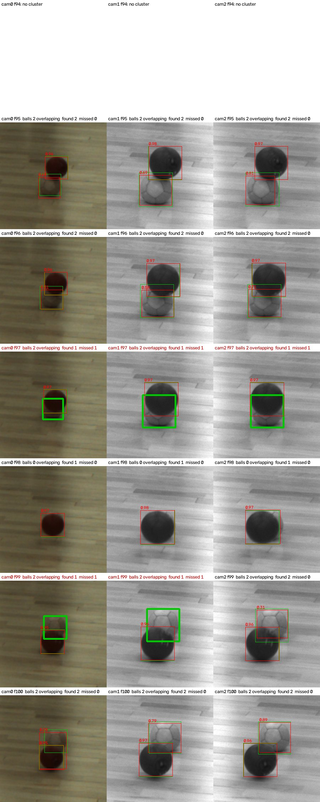

# 첫 학습 보고 (2026-10-09)

보치아 공 검출기의 첫 학습과 평가입니다. 데이터는 네이티브 라벨러로 검수한 라벨이고, 모델은 YOLO26(Ultralytics 8.4.174)입니다. 사용자가 학습을 처음 접하므로 각 수치의 뜻을 같이 적었습니다.

## 데이터

| 분할 | 촬영 | 이미지 | 공 | 비고 |
| --- | --- | --- | --- | --- |
| 학습 train | 01~06 | 3,621 | 6,727 | 확인 완료 + 라벨 전파분 |
| 검증 val | 07 | 498 | 1,252 | 학습 중 "잘 되고 있나" 보는 용도 |
| 테스트 test | 08·09 | 1,050 | 2,062 | 학습에 전혀 쓰지 않은 최종 평가용 |

- 내보내기: `C:\boccia-train\export\20261009-021405-bed880d6` (데이터 버전 `ff9d2a87…`로 분할 확정). PNG 1440×1080, YOLO 형식(클래스 `boccia_ball` 하나).
- 분할은 촬영(녹화) 단위입니다. 같은 녹화의 비슷한 프레임이 학습과 테스트에 갈라져 들어가면 점수가 부풀기 때문입니다.
- 검증 촬영 07은 학습 촬영과 같은 체육관·같은 공이라 검증 점수는 낙관적입니다. 진짜 성적은 테스트(08·09)입니다.

## 학습

| 항목 | 값 |
| --- | --- |
| 모델 | `yolo26n.pt` (가장 작은 YOLO26, 일반 사진으로 미리 학습된 가중치에서 출발) |
| 설정 | 40바퀴(epochs), 이미지 긴 변 1280, 한 번에 8장(batch), 15바퀴 정체 시 조기 종료 |
| 시간 | 약 1시간 (RTX 5060 Ti 16 GB) |
| 최고 검증 점수 | 37바퀴째 mAP50-95 0.981 |
| 가중치 | `C:\boccia-train\runs\detect\runs\yolo26n-e40\weights\best.pt` |

연습으로 3바퀴만 돌린 모델도 검증 mAP50-95 0.973이었습니다. 공은 배경과 잘 구분되는 물체라 빨리 배웁니다.

## 테스트 결과 (촬영 08·09, 1,050장, 공 2,062개)

| 지표 | 값 | 뜻 |
| --- | --- | --- |
| 정밀도 | 0.998 | 공이라고 찍은 것 중 진짜 공의 비율 |
| 재현율 | 0.983 | 실제 공 중 찾아낸 비율 |
| mAP50 | 0.994 | 박스가 정답과 절반 이상 겹치면 맞다고 칠 때의 점수 |
| mAP50-95 | 0.920 | 겹침 기준을 50~95%로 높여 가며 평균한 엄격한 점수 |
| 추론 속도 | 5.2 ms/장 (GPU) | |

연구가 필요로 하는 "공 중심 위치" 기준으로도 봤습니다(`tools/train/eval_centres.py`, 예측 중심이 정답 공의 반지름 안에 들면 찾은 것으로 침).

| 카메라 | 공 | 찾음 | 놓침 | 오검출 | 중심 오차 중앙값 | p95 |
| --- | --- | --- | --- | --- | --- | --- |
| camera-0 (컬러) | 705 | 695 | 10 | 4 | 0.48 px | 1.36 px |
| camera-1 (모노 A) | 679 | 670 | 9 | 6 | 0.34 px | 0.78 px |
| camera-2 (모노 B) | 678 | 669 | 9 | 5 | 0.27 px | 0.59 px |
| 전체 | 2,062 | 2,034 | 28 (1.4%) | 15 | 0.30 px | |

중심 오차가 1 px 안쪽이라 3카메라 위치 계산에 바로 쓸 만합니다.

## 놓친 공은 무엇인가

놓친 28개는 촬영 09의 77~83, 97~99, 171 프레임에 몰려 있고, 그림으로 확인하니 두 종류입니다(`C:\boccia-train\runs\misses\`).

1. **던져서 공중에 떠 있는 공**: 선수 손을 막 떠난 공으로, 가슴 높이에 작고 흐릿하게 찍힙니다. 세 카메라 모두에서 놓쳤습니다.
2. **화면 가장자리에 걸린 공**: 아래 가장자리에 반쯤 잘린 공.

둘 다 학습 데이터에 거의 없는 모양입니다. 학습 촬영(01~07)의 초안 씨앗이 바닥 공 위주의 스테레오 매칭에서 나와, 공중 공이 라벨에 빠졌을 가능성이 큽니다. 바닥 위치 측정이 목적이면 공중 공은 덜 중요하지만, 궤적 추적까지 하려면 학습 촬영에서 던지는 순간의 공을 "공 추가"로 더 라벨링하는 것이 가장 효과적인 개선입니다. 오검출 15개는 신발·그림자에 찍힌 것인데, 확신 기준을 0.25에서 0.4로 올려도 11개만 남고 대신 놓치는 공이 4개 늘어서(32개), 기준은 0.25~0.3이 낫습니다. 오검출은 기준보다 데이터로 줄일 문제입니다.

## 한 단계 큰 모델과 비교 (yolo26s)

같은 데이터·설정으로 `yolo26s.pt`를 학습했습니다(39바퀴에서 조기 종료, 1.4시간, 최고 검증 24바퀴째).

| 테스트(08·09) | yolo26n | yolo26s |
| --- | --- | --- |
| 정밀도 / 재현율 | 0.998 / 0.983 | 0.996 / 0.980 |
| mAP50 | 0.994 | 0.994 |
| mAP50-95 | 0.920 | **0.961** |
| 찾음 / 놓침 / 오검출 (중심 기준) | 2,034 / 28 / 15 | 2,033 / 29 / 21 |
| 중심 오차 중앙값 | 0.30 px | 0.30 px |
| 중심 오차 p95 (컬러 / 모노 A / 모노 B) | 1.36 / 0.78 / 0.59 px | 0.90 / 0.95 / 0.87 px |
| 추론 속도 (GPU) | 5.2 ms/장 | 11.1 ms/장 |

- 큰 모델은 박스가 정답에 더 꼭 맞습니다(mAP50-95 0.92→0.96). 그러나 연구가 쓰는 중심 위치는 둘 다 중앙값 0.3 px로 같고, 놓치는 공도 같은 공중 공입니다. 즉 놓침은 모델 크기가 아니라 데이터(공중 공 라벨 부족)의 문제입니다.
- 실시간 C++ 파이프라인에는 두 배 빠른 yolo26n을, 박스 자체의 정밀도가 중요하면 yolo26s를 권합니다. 가중치: `C:\boccia-train\runs\detect\runs\yolo26s-e40\weights\best.pt`.

### 같은 스크립트로 다시 비교: ONNX, 앱 경로 (2026-10-09 20:05)

yolo26s도 `nms=True`, 1280으로 ONNX(36.9 MB, `data/models/boccia/yolo26s-20261009.onnx`)로 내보내 yolo26n과 똑같이 앱의 레터박스 경로로 돌렸다(`tools/train/onnx_predict.py`). 위 표의 Ultralytics val 수치와 달리 둘 다 같은 조건이다.

| 테스트(08·09), 확신 0.25 | yolo26n | yolo26s |
|---|---|---|
| mAP50 / mAP50-95 | 0.980 / 0.911 | 0.980 / **0.947** |
| 찾음 / 놓침 / 오검출 (중심 기준) | 2,033 / 29 / **17** | 2,035 / 27 / 20 |
| 확신 0.4에서 놓침 / 오검출 | 32 / 14 | 34 / 16 |
| 중심 오차 중앙값 (컬러 / 모노 A / 모노 B) | 0.31 px (0.50 / 0.34 / 0.28) | 0.30 px (**0.28** / 0.33 / 0.39) |
| 중심 오차 p95 (컬러 / 모노 A / 모노 B) | 1.36 / 0.78 / 0.59 px | 0.90 / 0.95 / 0.87 px |
| 겹친 공 찾음 (IoU 0.1~0.3 / 0.3 이상) | 16/18 / 3/6 | 16/18 / 3/6 |
| ONNX 파일 | 10.3 MB | 36.9 MB |
| CPU 장당, ONNX Runtime 4 / 8 / 16스레드 (i7-13700K) | **62 / 38 / 37 ms** | 191 / 114 / 107 ms |
| GPU 장당, PyTorch batch 1 전후처리 포함 (RTX 5060 Ti) | **10.0 ms** | 15.0 ms |

- 놓치는 공은 같은 공(공중 공, 09번 97·99 프레임의 가려진 공)이고 개수도 거의 같다(29 대 27). 겹친 공 결과도 같다.
- 차이는 박스가 정답에 얼마나 꼭 맞느냐(mAP50-95 0.911 → 0.947)다. 연구가 쓰는 중심 위치는 전체 중앙값이 둘 다 0.3 px로 같지만, 공이 작은 컬러 카메라에서는 s가 뚜렷이 낫다(중앙값 0.50 → 0.28 px, p95 1.36 → 0.90 px). 모노 두 대는 n이 조금 낫다.
- 속도는 CPU에서 3배, GPU에서 1.5배 차이.
- **결론**: CPU로 실시간이면 yolo26n. CUDA 실행을 붙이면 s도 장당 15 ms로 실시간 범위에 들어오므로, 컬러 카메라 중심 정밀도가 중요하면 그때 s로 바꿀 수 있다. 앱의 Model 항목에서 파일만 바꾸면 된다.

### 배포 모델 변형: 바이트 입력과 fp16 (2026-10-10)

`tools/train/onnx_variants.py`는 내보낸 ONNX에서 두 변형을 만든다. **바이트 입력**(`-u8`)은 /255와 채널 순서 바꾸기를 그래프 안으로 옮겨 입력이 uint8 [1,1280,1280,3]이 되므로 앱이 GPU에 올리는 데이터가 1/4이고 CPU 쪽 float 변환이 없어진다. **fp16**(`-u8-fp16`)은 몸통만 fp16이고 헤드의 박스 계산(앵커·스트라이드)과 NMS는 fp32로 남겨 좌표 정밀도를 지킨다(onnxconverter-common이 ONNX Runtime이 거부하는 모델을 만들어 변환은 직접 구현).

| 테스트(08·09), 같은 스크립트 | float 입력 | 바이트 입력 fp32 | 바이트 입력 fp16 |
|---|---|---|---|
| mAP50-95 | 0.911 | 0.911 | 0.911 |
| 찾음 / 놓침 / 오검출 | 2,033 / 29 / 17 | 2,033 / 29 / 17 | 2,033 / 29 / 17 |
| 중심 오차 중앙값 (p95 모노 A) | 0.31 px (0.78) | 0.31 px (0.78) | 0.31 px (0.79) |
| CUDA 장당, 전처리 포함 (RTX 5060 Ti, ONNX Runtime C++) | 23.6 ms | **12.5 ms** | 15.0 ms (NHWC 옵션이면 12.7 ms) |

- 바이트 입력은 결과가 float 입력과 완전히 같고 CUDA 시간을 절반으로 줄여 앱의 배포 모델(`models/boccia-yolo26n.onnx`, `boccia-yolo26s.onnx`)로 썼다. 검출기는 float 입력 모델도 그대로 읽는다.
- fp16은 정밀도 손실이 없지만(p95 0.01 px 차이) 이 GPU에서는 빨라지지 않는다. 모델이 작아 시간이 합성곱 연산량이 아니라 커널 호출과 메모리 이동에 쓰이기 때문이다. 배포하지 않고, 모델 옆에 `<이름>-fp16.onnx`가 있으면 CUDA에서 자동으로 쓰는 경로만 남겼다.
- 남은 12.5 ms 가운데 CPU 전처리(레터박스·색 변환)는 약 1.5 ms. 더 줄이려면 카메라 3장을 한 번에 넣는 배치 처리나 CUDA 그래프가 다음 수단이다.

## 다른 모델과 비교 ① RT-DETR-L (2026-10-09 13:31 학습 종료)

같은 데이터(학습 01~06, 검증 07)로 RT-DETR-L(Ultralytics 구현, 30 에폭, imgsz 1280, batch 4)을 학습했다. 검증(07) mAP50-95는 0.990(best 29 에폭). 아래 표는 테스트 세트(08·09)에서 **두 모델을 같은 스크립트로** 잰 값이다. 0.05 이상 예측을 COCO 결과로 저장한 뒤(`tools/train/onnx_predict.py`는 앱이 쓰는 ONNX를 앱과 같은 레터박스로, `tools/train/ultralytics_predict.py`는 체크포인트를 그대로) `coco_map.py`·`eval_centres_coco.py`·`overlap_stats.py`로 평가했다. 그래서 yolo26n 숫자가 위의 Ultralytics val 표와 조금 다르다.

| 테스트(08·09), 확신 0.25 | yolo26n (ONNX, 앱 경로) | RT-DETR-L |
|---|---|---|
| mAP50 / mAP50-95 | 0.980 / 0.911 | **0.990 / 0.949** |
| 찾음 / 놓침 / 오검출 (중심 기준) | 2,033 / 29 / 17 | **2,054 / 8** / 38 |
| 재현율 | 0.986 | **0.996** |
| 중심 오차 중앙값 | 0.31 px | 0.32 px |
| 중심 오차 p95 (컬러 / 모노 A / 모노 B) | 1.36 / 0.78 / 0.59 px | 0.82 / 1.34 / 1.27 px |
| 겹친 공 찾음 (IoU 0.1~0.3 / 0.3 이상) | 16/18 / 3/6 | **18/18** / 3/6 |
| 추론 (GPU, RTX 5060 Ti) | 5.2 ms/장 | 25.9 ms/장 |
| 추론 (CPU, i7-13700K) | 65 ms/장 (ONNX Runtime 4스레드) | 약 840 ms/장 (PyTorch 8스레드) |

- RT-DETR-L은 공중 공(09번 77~83 프레임)과 중간 정도 겹친 공을 더 잘 찾는다(놓침 29→8). 대신 오검출이 두 배이고, 확신을 0.7까지 올려도 25개가 남아 문턱값으로는 걸러지지 않는다(0.4: 놓침 19/오검출 31, 0.7: 27/25).
- 중심 정밀도는 같다(중앙값 0.3 px). 거의 다 가려진 공(09번 97 프레임, 세 카메라 모두)은 둘 다 놓친다.
- 5배 느리고 CPU에서는 못 쓰므로 실시간 파이프라인은 여전히 yolo26n이다. RT-DETR-L은 라벨링 보조(초안에서 빠진 공 찾기)나 오프라인 분석에 쓸 수 있다. 가중치 `C:\boccia-train\runs\detect\runs\rtdetr-l-e30\weights\best.pt`.
- D-FINE-S(40 에폭)와 Faster R-CNN(12 에폭)은 큐에서 이어서 학습 중이며, 끝나는 대로 같은 표에 넣는다.

## 다른 모델과 비교 ② Faster R-CNN (2026-10-09 15:23 학습 종료)

torchvision의 Faster R-CNN ResNet-50 FPN v2(COCO 사전학습)를 `tools/train/train_frcnn.py`로 12 에폭(긴 변 1280, batch 4, SGD 0.01) 학습했다. 검증(07) mAP50-95는 0.986(best 9 에폭). 테스트(08·09)는 위와 같은 스크립트로 쟀다.

| 테스트(08·09) | Faster R-CNN, 확신 0.25 | 확신 0.5 |
|---|---|---|
| mAP50 / mAP50-95 | 0.989 / 0.935 | |
| 찾음 / 놓침 / 오검출 (중심 기준) | 2,050 / 12 / 33 | 2,046 / 16 / 17 |
| 중심 오차 중앙값 (p95 컬러 / 모노 A / 모노 B) | 0.46 px (0.97 / 1.45 / 1.28) | 0.46 px |
| 겹친 공 찾음 (IoU 0.1~0.3 / 0.3 이상) | 17/18 / 4/6 | |

- 놓침은 RT-DETR-L(8)과 yolo26n(29) 사이이고, 오검출은 확신 0.5에서 17개로 yolo26n 수준이 된다. 많이 겹친 공은 6개 중 4개로 셋 중 가장 많이 찾았다.
- 중심 오차 중앙값 0.46 px로 다른 둘(0.31)보다 뚜렷이 크다. 2단계 검출기의 박스 회귀가 거칠어서이며, 연구가 쓰는 중심 위치에서는 불리하다.
- 추론 속도는 D-FINE 학습이 끝나 GPU가 비면 같은 조건으로 잰다. ResNet-50 FPN을 1280으로 돌리므로 yolo26n보다 열 배 안팎 느릴 것으로 본다.
- 첫 실행은 윈도우의 데이터 로더 워커(spawn)가 모듈을 다시 불러오며 학습을 또 시작해 바로 죽었다. 학습 코드를 `main()` 아래로 옮겨 고쳤다.

## 다른 모델과 비교 ③ D-FINE-S, 그리고 네 모델 한눈에 (2026-10-09 18:00)

D-FINE-S(HGNetv2-B0, COCO 사전학습 `dfine_s_coco.pth`, Apache-2.0)를 공식 저장소 코드로 24 에폭(1280×1280, batch 4, AdamW 2e-4, 단일 해상도) 학습했다. 검증(07) mAP50-95는 0.985(best 23 에폭). 처음 설정(batch 8, 다중 해상도 최대 1440)은 GPU 메모리 18.4 GB가 필요해 16 GB 카드에서 시스템 메모리로 넘쳐 반복당 11초(55시간)가 걸려 중단했고, batch 4·단일 해상도로 바꾸니 반복당 0.38초, 6 GB로 2시간 반에 끝났다. 설정은 `tools/train/dfine/`.

| 테스트(08·09), 확신 0.25 | yolo26n (ONNX, 앱 경로) | RT-DETR-L | Faster R-CNN R50 v2 | D-FINE-S |
|---|---|---|---|---|
| 검증(07) mAP50-95 | 0.981 | 0.990 | 0.986 | 0.985 |
| 테스트 mAP50 / mAP50-95 | 0.980 / 0.911 | 0.990 / **0.949** | 0.989 / 0.935 | 0.990 / 0.925 |
| 찾음 / 놓침 / 오검출 (중심 기준) | 2,033 / 29 / **17** | 2,054 / **8** / 38 | 2,050 / 12 / 33 | 2,039 / 23 / 85 |
| 오검출을 비슷하게 맞춘 문턱값에서 놓침 / 오검출 | 29 / 17 (0.25) | 27 / 25 (0.7) | 16 / 17 (0.5) | 32 / 19 (0.4) |
| 중심 오차 중앙값 | **0.31 px** | 0.32 px | 0.46 px | 0.45 px |
| 겹친 공 찾음 (IoU 0.1~0.3 / 0.3 이상) | 16/18 / 3/6 | 18/18 / 3/6 | 17/18 / **4/6** | 18/18 / 3/6 |
| GPU 장당 시간 (batch 1, 전처리·후처리 포함, RTX 5060 Ti) | **10.0 ms** | 50.8 ms | 74.8 ms | 24.1 ms |
| 가중치 (`C:\boccia-train\`) | runs/detect/runs/yolo26n-e40 | runs/detect/runs/rtdetr-l-e30 | runs/frcnn/best.pt | runs/dfine-s/best_stg2.pth |
| 라이선스 | AGPL-3.0 (Ultralytics) | AGPL-3.0 (Ultralytics 구현; 원저자 구현은 Apache-2.0) | BSD (torchvision) | Apache-2.0 |

GPU 시간은 `tools/train/bench_gpu.py`로 같은 50장을 한 장씩 넣어 잰 값(디코딩 제외, 각 모델의 전처리·후처리 포함)이라 Ultralytics val이 보고하는 순수 추론 시간(yolo26n 5.2 ms)보다 크다. yolo26s는 같은 조건에서 15.0 ms.

- D-FINE-S는 0.25에서 오검출 85개로 많지만 점수 눈금이 낮은 편이라 0.4~0.5에서는 다른 모델과 비슷해진다(0.5: 놓침 35/오검출 14). 중심 오차 0.45 px는 Faster R-CNN과 같은 수준으로 yolo26n·RT-DETR-L(0.31)보다 크다. 1440×1080을 1280×1280으로 눌러 넣는 학습·추론 방식(가로세로비 왜곡)이 한 원인일 수 있다.
- **결론**: 공 중심 정밀도와 속도가 중요한 실시간 파이프라인에는 yolo26n이 가장 맞다(중심 0.31 px, 10 ms, 오검출 최소). RT-DETR-L은 놓침이 가장 적어 오프라인 보조(라벨 초안에서 빠진 공 찾기)에 쓸 만하고, Faster R-CNN과 D-FINE-S는 이 데이터에서 이점이 없다. AGPL이 문제가 되면 Apache-2.0인 D-FINE-S가 대안이며, 그때는 중심 오차를 줄이기 위해 레터박스 입력으로 다시 학습해 볼 가치가 있다.

## 겹친 공은 왜 놓치나

학습 라벨 6,727개 중 다른 공과 박스가 겹치는(IoU 0.1 이상) 공은 46개(0.7%), 많이 겹치는(0.3 이상) 공은 18개뿐이다. 테스트에서 yolo26n은 안 겹친 공의 98.8%, 겹친 공(0.1~0.3) 18개 중 16개, 많이 겹친 공 6개 중 3개를 찾았다(`tools/train/overlap_stats.py`).



09번 촬영 95~100 프레임(빨간 공이 흰 공 앞을 지나감, `tools/train/show_cluster.py`). 97 프레임은 흰 공이 아래 한 줄만 보여서 라벨 규칙("바닥 겹침은 공 전체")상 라벨은 있지만 어떤 모델도 못 찾는다. 99 프레임은 절반 넘게 보이는데도 모노 두 대에서 0.05 이상 후보조차 없다. 이것이 데이터로 고칠 수 있는 경우다. NMS 탓은 아니다. 원시 출력에 NMS(IoU 0.5)를 따로 건 쪽이 겹침에서 더 나빴다(18개 중 5개 놓침). 대책은 공이 서로 앞을 지나거나 몰린 장면의 추가 촬영·라벨, 또는 공을 잘라 다른 공 위에 겹쳐 붙이는 합성 증강이다.

## 재현 방법

```bash
cd C:\boccia-train
.venv\Scripts\yolo detect train data=export/20261009-021405-bed880d6/data.yaml model=yolo26n.pt epochs=40 imgsz=1280 batch=8 workers=4 patience=15 project=runs name=yolo26n-e40
.venv\Scripts\yolo detect val model=runs/detect/runs/yolo26n-e40/weights/best.pt data=export/20261009-021405-bed880d6/data.yaml split=test imgsz=1280
.venv\Scripts\python tools\train\eval_centres.py runs/detect/runs/yolo26n-e40/weights/best.pt export/20261009-021405-bed880d6 split=test
```

(`tools/train/`의 스크립트는 저장소에, 데이터·가중치·가상환경은 `C:\boccia-train`에 있습니다. D: 드라이브는 여유가 없어 C:를 씁니다.)

## 다음

- 공중 공·가장자리 공·겹친 공 장면 라벨 보강(추가 촬영 또는 합성 증강) → 재학습.
- (완료 2026-10-09) RT-DETR-L·Faster R-CNN·D-FINE-S를 같은 테스트 세트에서 비교(③ 절의 표).
- (완료 2026-10-09) yolo26n ONNX를 캘리브레이션 앱에 연결: Ball Detection 패널 맨 위 Model 항목.
